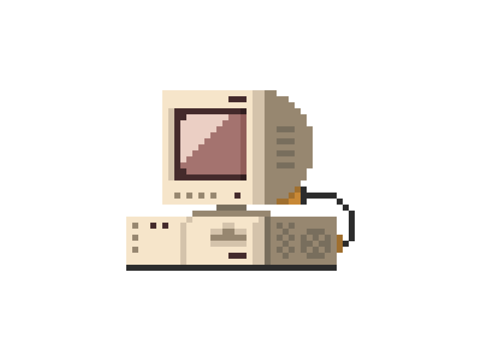

# Olá, Sou Vivi. 


Sou uma desenvolvedora Back-End em <b>transição de carreira</b>, vindo da área de informática para o desenvolvimento de software. 

Formada em **Análise e Desenvolvimento de sistemas**.

---


### Minha jornada de código na última semana

<!--START_SECTION:waka-->

```txt
Python      40 mins               █████████████░░░░░░░░░░░░   52.38 %
Bash        19 mins               ██████▒░░░░░░░░░░░░░░░░░░   25.55 %
YAML        10 mins               ███▒░░░░░░░░░░░░░░░░░░░░░   13.17 %
Markdown    3 mins                █░░░░░░░░░░░░░░░░░░░░░░░░   04.47 %
Caddyfile   3 mins                █░░░░░░░░░░░░░░░░░░░░░░░░   04.44 %
```

<!--END_SECTION:waka-->
